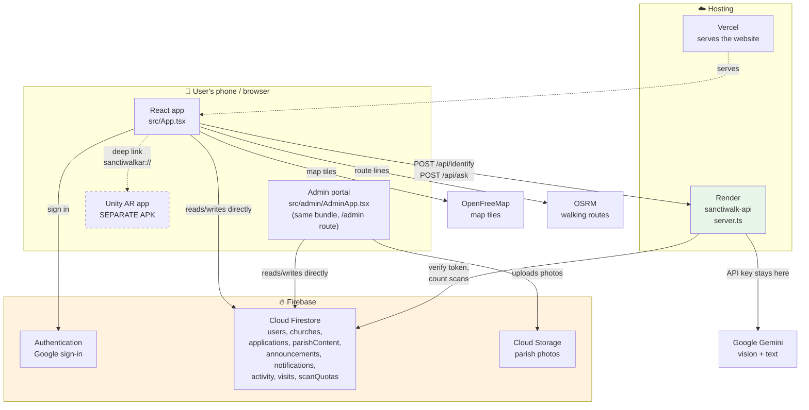

# SanctiWalk — Developer Learning Guide

**A plain-English manual for the people who built it.**

Written for: a 4th-year BSIT student who needs to explain this system to a capstone panel without anyone's help.

Everything in this guide was checked against the actual code in `D:\SanctDemo` and `D:\SanctiWalkAR`. Where something could not be verified, it says so out loud instead of guessing.

**Last verified:** 19 October 2026 · 179 commits · 985 tests passing · typecheck clean

---

## Table of contents

1. [Start here: the whole thing in one page](#1-start-here)
2. [What problem SanctiWalk solves](#2-what-problem-sanctiwalk-solves)
3. [The vocabulary nobody explained to you](#3-the-vocabulary-nobody-explained-to-you)
4. [The tools: IDE, editor, framework, runtime — what's the difference?](#4-the-tools)
5. [The technologies actually used](#5-the-technologies-actually-used)
6. [System architecture](#6-system-architecture)
7. [Folder and file guide](#7-folder-and-file-guide)
8. [Frontend: how the screens work](#8-frontend)
9. [Backend and API reference](#9-backend-and-api-reference)
10. [Firebase, Firestore and where data actually lives](#10-firebase-firestore-and-where-data-lives)
11. [How the admin portal connects to the main app](#11-how-the-admin-portal-connects)
12. [Feature-by-feature status](#12-feature-by-feature-status)
13. [React → Capacitor → Android APK](#13-react--capacitor--android-apk)
14. [Unity and the AR tour](#14-unity-and-the-ar-tour)
15. [How to trace code in VS Code](#15-how-to-trace-code-in-vs-code)
16. [Testing and debugging](#16-testing-and-debugging)
17. [Security and maintenance](#17-security-and-maintenance)
18. [Methodology (and the honest answer about it)](#18-methodology)
19. [Capstone defense reviewer](#19-capstone-defense-reviewer)
20. [Glossary](#20-glossary)
21. [Study plan](#21-study-plan)

---

## 1. Start here

**The one-paragraph version:**

SanctiWalk is a **website** that pretends to be a **phone app**. You write it in React (a way of building websites). A tool called **Capacitor** wraps that website inside an Android app so it gets an icon and opens without a browser. Some things a website cannot do — like holding a secret API key — are done by a small **server** (`server.ts`) living on Render. Data lives in **Firebase**. And the fancy augmented-reality tour is a **completely separate app** made in Unity that SanctiWalk opens like you'd open Messenger from a link.

**The donkey version:** 🫏

Imagine SanctiWalk is a *food cart*.

- **React** = the cart itself — the thing people see and touch.
- **Vite** = the factory that assembles the cart from parts.
- **Capacitor** = putting wheels and a licence plate on the cart so it can drive on the road (Android) instead of just sitting in your yard (the browser).
- **Express (`server.ts`)** = the kitchen out the back, because you don't let customers near the secret recipe (the Gemini API key).
- **Firebase** = the warehouse where you keep all the ingredients and the customer list.
- **Unity** = a *different food cart entirely*, parked next door, that you point customers to when they want the fancy thing.
- **VS Code** = your toolbox.
- **Android Studio** = the specific heavy machine that bolts on the wheels.

If you remember only that, you can already answer half the panel's questions.

---

## 2. What problem SanctiWalk solves

**The problem:** a visitor walks into an unfamiliar parish church in the Diocese of Kalookan. They don't know the Mass times, don't know what the statues mean, don't know the church's history, don't know how to join a ministry or arrange a baptism. The information exists — but it's on a tarpaulin by the door, in the parish office, or in somebody's head.

**The users:**

| User | What they want |
|---|---|
| Visitors / pilgrims | Mass times, directions, what am I looking at, church history |
| Parishioners | Join a ministry, apply for a sacrament, daily Rosary |
| Parish staff (admins) | Publish accurate information without needing a developer |

**The central claim of the project** (from `PROJECT-STATE.md`): *the app detects which parish you are standing at and reshapes itself around that place.*

**Scope note (verified in the capstone paper):** the system covers the diocese but **only two parishes are implemented in full** — Mary Help of Christians Parish (`route-mhcp`) and San Roque Cathedral Parish (`route-src`). The paper gives a reason: accuracy. Every station description and sacramental requirement is confirmed with the parish, and that verification is the bottleneck, not the code.

---

## 3. The vocabulary nobody explained to you

Learn these seven words and most confusion disappears.

| Word | What it actually means | SanctiWalk example |
|---|---|---|
| **Language** | The words you write code in | TypeScript, C# |
| **Runtime** | The thing that *runs* the code | Node.js (server), the browser (app) |
| **Framework / library** | Pre-written code so you don't start from zero | React, Express |
| **Build tool** | Turns your source files into files a browser can use | Vite |
| **Editor / IDE** | The program you type in | VS Code, Android Studio, Unity Editor |
| **Package manager** | Downloads other people's code | npm |
| **Hosting / deployment** | Where your finished thing lives on the internet | Vercel, Render |

**The classic mix-up:** React is **not** an IDE and **not** a language. React is a *library* written in JavaScript. You write React code *inside* VS Code. VS Code doesn't know or care that it's React.

---

## 4. The tools

### Is VS Code an IDE or an editor?

**Short answer for the panel:** *"VS Code is technically a code editor, but with extensions it behaves like an IDE. We use it as our main development environment."*

A real **IDE** (Integrated Development Environment) comes with everything welded together: editor + compiler + debugger + build system. Android Studio and Unity Editor are true IDEs.

**VS Code** starts as a very good text editor and you bolt on what you need. For SanctiWalk that's TypeScript checking, ESLint, and the terminal. That's why it's fast and why it can handle a React project, a Node server and a bunch of Python tools in one window.

### Why three different tools?

| Tool | What you open in it | Why you can't use VS Code instead |
|---|---|---|
| **VS Code** | `D:\SanctDemo` — all the React/TypeScript/server code | — this is the main one |
| **Android Studio** | `D:\SanctDemo\android` | It runs **Gradle**, manages the Android SDK, and talks to the phone. VS Code can't build an APK. |
| **Unity Editor** | `D:\SanctiWalkAR` | AR scenes are 3D. You place objects in a 3D view, not in text. |

**"Android Studio is not Android."** Android is the operating system on the phone. Android Studio is a program on your laptop for *making* Android apps. Same relationship as "Microsoft Word is not a letter."

### What Claude (AI) does and does not do

Be honest about this with your panel — they will ask.

**It does:** write code when asked, explain code, find bugs, run tests and commands, read the repo.

**It does not:** make decisions for you, know your parish's real Mass times, guarantee correctness, or understand your capstone requirements unless you explain them. Every line still has to be something *you* can defend. If you can't explain a file, you don't yet own it — that's what this guide is for.

### React vs. building natively in Kotlin/Java

| | React + Capacitor (what we did) | Native Kotlin/Java |
|---|---|---|
| Write once, run on web + Android | ✅ | ❌ one codebase per platform |
| Team already knows web | ✅ | ❌ new language to learn |
| Full access to phone hardware | ⚠️ only via plugins | ✅ everything |
| Heavy 3D / AR | ❌ (that's why Unity is separate) | ✅ |
| App size | Bigger (ships a browser engine) | Smaller |
| Speed | Good enough for this | Faster |

**Defense answer:** *"We chose React with Capacitor because SanctiWalk is mostly information screens, and one codebase gives us both a website and an Android app. Where that approach genuinely couldn't cope — the AR tour, which needs ARCore world tracking — we used the right tool instead, which is Unity."*

That answer is strong because it admits a limit and shows you worked around it deliberately.

---

## 5. The technologies actually used

Verified from `package.json`. I checked each one is really used, not just installed.

### Frontend

| Tech | Version | What it does here | Where to look |
|---|---|---|---|
| **React** | 19.0.1 | Builds every screen | `src/components/` (70 files) |
| **TypeScript** | 5.8 | JavaScript with type checking | everywhere (`.ts`, `.tsx`) |
| **Vite** | 6.2 | Dev server + builds for production | `vite.config.ts` |
| **Tailwind CSS** | 4.1 | Styling via class names | `className="flex gap-2"` |
| **react-router-dom** | 7.18 | URL routing (`/admin`, `/finish-sign-in`) | `src/main.tsx` |
| **MapLibre GL** | 6.5 | The real street map | `src/components/DioceseMapLive.tsx` |
| **lucide-react** | 0.546 | Icons | `import { Camera } from "lucide-react"` |
| **jsQR** | 1.4 | Reads QR codes from the camera | `src/components/ArTour.tsx` |
| **motion** | 12.23 | Animations | various components |

### Backend

| Tech | What it does here | Where |
|---|---|---|
| **Node.js 22** | Runs the server | `render.yaml` sets `NODE_VERSION: 22` |
| **Express 4.21** | Handles API routes | `server.ts` |
| **@google/genai 2.4** | Calls Gemini for the scanner and Ask Sancti | `server.ts` |
| **firebase-admin 14.5** | Server-side Firestore + verifying who's logged in | `src/lib/scanQuotaStore.ts` |
| **nodemailer 9** | Sends email | `server.ts` `/api/send-email` |
| **tsx / esbuild** | Runs TS directly in dev / bundles for production | `package.json` scripts |

### Mobile & AR

| Tech | What it does here |
|---|---|
| **Capacitor 8** | Wraps the web app as an Android app |
| **@capacitor-firebase/authentication** | Native Google sign-in picker |
| **@capacitor-community/text-to-speech** | The narration voice on the phone |
| **@capacitor/local-notifications** | Mass-schedule change alerts |
| **Unity + ARCore** | The AR tour — **separate app**, see Part 14 |

### Things worth flagging

- **`three` (0.186) and `mind-ar` (1.2.5) are installed.** I did not verify where, or whether, they are actively used in a shipped screen. **Check before claiming these in your defense** — search the repo for `from "three"` and `mind-ar`.
- **Firebase Realtime Database and Cloud Storage:** the `firebase` package includes them, but the code uses **Firestore** and **Storage** (for parish photos). Don't claim Realtime Database — I saw no evidence of it.

---

## 6. System architecture



### Reading that diagram in plain English

1. **The app talks to Firestore directly.** Most data — parishes, applications, announcements — goes straight from the React app to Firebase. There is no backend in the middle. Security is enforced by **Firestore security rules** (`firestore.rules`), not by your server.

2. **The backend exists for one reason: secrets.** `server.ts` holds `GEMINI_API_KEY`. If that key shipped inside the APK, anyone could unpack the app and spend your Gemini quota. So the phone sends the *photo* to Render, and Render talks to Gemini.

3. **The admin portal is the same app.** It's not a separate website. It's the `/admin` route in the same React bundle (`src/main.tsx` line 8 imports `AdminApp`). Same Firebase, same Firestore, same deployment.

4. **Unity is genuinely separate.** The dotted line is a *deep link*, not a function call. See Part 14.

### Which bit runs where

| Runs on the phone/browser | Runs on Render | Runs in Firebase | Runs in Unity |
|---|---|---|---|
| All React screens | `server.ts` | Authentication | AR tracking |
| Map rendering | Gemini calls | Firestore reads/writes | 3D models |
| QR scanning | Scan quota counting | Security rules | Marker detection |
| Text-to-speech | Email sending | Photo storage | Station audio |
| The Rosary | | | |

---

## 7. Folder and file guide

### Top level

```
D:\SanctDemo\
├── src/                  ← all the app code
├── android/              ← the Android project (Capacitor generates this)
├── public/               ← files served as-is (includes the Rosary app!)
├── docs/                 ← documentation (you are here)
├── dist/                 ← build output (generated, don't edit)
├── server.ts             ← THE BACKEND. One file.
├── package.json          ← dependencies + commands
├── capacitor.config.ts   ← Android packaging settings
├── firestore.rules       ← database security
├── vercel.json           ← frontend hosting config
├── render.yaml           ← backend hosting config
└── vite.config.ts        ← build config
```

### `src/` — the app

| Path | Files | What's in it |
|---|---|---|
| `src/main.tsx` | 1 | **Entry point.** Mounts React, sets up routes |
| `src/App.tsx` | 1 | The main shell: tab bar, screen switching (~1550 lines) |
| `src/components/` | 70 | Every screen and widget |
| `src/lib/` | 149 | Logic with no UI — the testable half |
| `src/admin/` | 16 | The admin portal |
| `src/context/` | 5 | Shared state (e.g. where the user is) |
| `src/data.ts` | 1 | Hard-coded parish data |
| `src/types.ts` | 1 | Shared TypeScript types |

**The most important architectural habit in this project:** logic lives in `src/lib/` as *pure functions* so it can be tested without a browser, a phone or a network. The components just call them. That's why there are 985 tests.

Example: the follow-camera maths for navigation is in `src/lib/followCamera.ts`, tested in `followCamera.test.ts`, and *used* by `src/components/DioceseMapLive.tsx`. The comment in that file says it plainly: *"None of it can be exercised in a browser... Out here it is four pure functions over numbers."*

### Key files, by job

**Startup**
- `src/main.tsx` → `src/App.tsx` → the tab you're on

**Auth**
- `src/lib/firebase.ts` — starts Firebase from `firebase-applet-config.json`
- `src/lib/googleAuth.ts` — Google sign-in (native vs web paths)
- `src/routes/FinishSignIn.tsx`, `src/routes/SignUpFlow.tsx`

**Talking to the backend**
- `src/lib/apiBase.ts` — **where is the server?** (critical for APK, see Part 13)
- `src/lib/appKey.ts` — adds the `X-SanctiWalk-Key` header
- `src/lib/askSancti.ts` — the Ask Sancti request

**Data**
- `src/lib/parishContent.ts` — admin-managed parish info (live subscription)
- `src/data.ts` — compiled/hard-coded parish data
- `src/lib/scanQuota.ts` + `scanQuotaStore.ts` — the 20-scans-a-day rule

**Big features**
- `src/components/ArTour.tsx` — scanner + AR launcher (~1100 lines)
- `src/components/DioceseMapLive.tsx` — the map (~1600 lines)
- `src/components/SanctiHost.tsx` — Ask Sancti
- `src/components/ChurchHistory.tsx` — history + narration
- `public/rosary/index.html` — **the Rosary is a standalone HTML app in an iframe** (3188 lines)

---

## 8. Frontend

### What happens when the app starts

```
index.html
   └─ loads src/main.tsx
        ├─ wraps everything in <BrowserRouter>
        ├─ route "/"          → <App />
        ├─ route "/admin"     → <AdminApp />
        └─ route "/finish-sign-in" → <FinishSignIn />
```

`src/main.tsx` also installs a global error handler that prints stack traces with an `[SW-ERROR]` tag — because on a phone with no devtools, Android's log otherwise shows one useless line. That's a real debugging aid; remember it for Part 16.

### How a tap becomes an action — a real trace

Let's follow **"Listen" on the church history page**, which you can read end to end:

1. **Screen:** `src/components/ChurchHistory.tsx`
2. **The button:** `<button onClick={() => narration.toggle(script)} className="parish-history__listen">`
3. **The hook:** `narration` comes from `useNarration(language)` in `src/lib/useNarration.ts`
4. **The script:** `historyScript(title, sections, language)` from `src/lib/historyNarration.ts` — a pure function that assembles the text
5. **The voice:** `useNarration` calls `speakAloud()` in `src/lib/speech.ts`
6. **The decision:** `speech.ts` picks native TTS (in the APK) or browser speech (on a laptop), and selects a `fil-PH` or `en-US` voice

Six files, each with one job. That's the pattern across the whole app: **component → hook → pure function**.

### State, props and hooks in one minute

- **State** = something that can change and should redraw the screen. `const [open, setOpen] = useState(false)`
- **Props** = values passed *into* a component, like function arguments
- **Hook** = a function starting with `use` that gives a component a superpower (`useState`, `useEffect`, or custom ones like `useNarration`)
- **`useRef`** = a value that survives redraws but does *not* redraw the screen when changed. Used heavily here for things that change every GPS tick

The codebase explains its own choices. From `SanctiHost.tsx`:

> *"A ref, not state: it is read on the next message rather than rendered, and re-rendering the chat to remember a topic would repaint the whole sheet for nothing visible."*

---

## 9. Backend and API reference

**The entire backend is one file: `server.ts`.** In development it's run directly by `tsx`. For production, `esbuild` bundles it into `dist/server.cjs`, which is what Render runs via `npm start`.

### API reference (verified in `server.ts`)

| Method | Route | Purpose | Auth required | Input | Output |
|---|---|---|---|---|---|
| GET | `/api/health` | Is the server alive? | **No** (deliberately) | — | `{ok:true}` |
| POST | `/api/identify` | AI photo scanner | App key **+ Firebase sign-in** | base64 image, candidates | recognition JSON |
| GET | `/api/identify/budget` | Scans left today | App key + sign-in | `parishId` | budget JSON |
| POST | `/api/ask` | Ask Sancti (grounded AI) | App key | question, parishId, history | answer + sources |
| POST | `/api/generate-walk` | Generate a custom walk | App key | interest, location | walk JSON |
| GET | `/api/smtp-status` | Is email configured? | App key | — | `{configured}` |
| POST | `/api/send-email` | Send an email | App key | recipient, body | status |

**Why `/api/health` has no auth:** `render.yaml` explains it — Render calls it anonymously to check the service is alive. If it required the key, every deploy would be judged unhealthy and never go live.

### The two guards

**1. App key** — `requireAppKey()` in `server.ts`. The app sends header `X-SanctiWalk-Key`; the server compares it to `APP_KEY`. If `APP_KEY` isn't set, the guard is skipped (so local dev needs no config).

> ⚠️ **Be honest about this in your defense.** The app key is baked into the JavaScript bundle, which anyone can read. It stops casual abuse; it is **not** real security. The real protection for the scanner is the Firebase sign-in.

**2. Firebase sign-in** — `requireUser()` verifies the ID token with the Admin SDK. Without it you get:

```json
{"error":"Sign in to use the AI scanner...","code":"sign_in_required"}
```

This one is genuinely secure: tokens are verified against Google's keys and cannot be forged.

### Following a request end to end — the scanner

```
ArTour.tsx  takeScan()
  → idToken()                       get Firebase token
  → apiUrl("/api/identify")         src/lib/apiBase.ts decides the host
  → withAppKey({...})               src/lib/appKey.ts adds the header
  → fetch POST                      over the internet
      → Render: server.ts
          → requireAppKey()         header check
          → requireUser()           verify Firebase token
          → spendScan()             Firestore transaction, scanQuotas
          → ai.models.generateContent()   → Gemini
          ← JSON response
  ← setResult(...)                  draws the card
```

Every step above is real and you can click through it in VS Code.

### Environment variables (names only — never the values)

| Name | Where it's set | What it's for |
|---|---|---|
| `GEMINI_API_KEY` | Render dashboard | Calling Gemini |
| `APP_KEY` | Render dashboard | Must match `VITE_APP_KEY` |
| `FIREBASE_SERVICE_ACCOUNT` | Render dashboard | Server-side Firestore access |
| `VITE_API_BASE` | Build time (Vercel / `.env`) | **Where the backend lives** |
| `VITE_APP_KEY` | Build time | The app key the client sends |
| `DAILY_SCAN_LIMIT` | `render.yaml` | Default 20 |
| `SMTP_*` | Render dashboard | Email |

`.env` is gitignored. **Never** paste real values into documentation, chat, or screenshots.

---

## 10. Firebase, Firestore and where data lives

### The difference between the pieces

- **Authentication** = *who are you?* Google sign-in.
- **Firestore** = a database of documents, like folders of JSON files.
- **Cloud Storage** = files (photos), not data.
- **Our backend** = our own code; it is not Firebase.

### Collections (verified in `firestore.rules`)

| Collection | Holds | Written by |
|---|---|---|
| `users` | Profiles | App on sign-up |
| `churches` | Parish records | Admin |
| `parishContent` | Mass times, history, ministry/sacrament text, photos | **Admin portal** |
| `applications` | Ministry/sacrament applications | Users |
| `announcements` | Parish announcements | Admin |
| `notifications` | Per-user notifications | System |
| `activity` | Audit trail | System |
| `visits` | Visit records | App |
| `admins` | Who is an admin | Manually |
| `scanQuotas` | Daily scan counters | **Server only** |

**`scanQuotas` is locked down completely** — `allow read, write: if false;`. Only the Admin SDK on the server can touch it. That's deliberate: if the browser could write it, anyone could reset their own scan count.

### How admin edits reach users — the live path

This is the bit worth understanding properly.

`src/lib/parishContent.ts` exports `watchParishContent(parishId, callback)`. It uses Firestore's **real-time listener**. When an admin saves, Firestore pushes the change to every app currently watching that parish — no refresh, no polling.

```
Admin types new Mass time
  → saveParishContent()              src/lib/parishContent.ts
  → Firestore document parishContent/{parishId} updated
  → every open app with watchParishContent() running gets the new data
  → Mass card re-renders
```

**This is genuinely real-time, and you can say so**, because it uses Firestore's `onSnapshot`. That's one of the few places where "real-time" is an accurate word for this project.

### The data precedence rule

Parish information can come from two places, and they are not equal:

1. **`parishContent` in Firestore** — what the parish office typed. **Wins.**
2. **`src/data.ts`** — compiled into the app. Fallback.

You'll see this pattern repeatedly:

```ts
const schedule = managed?.massSchedule ?? compiled?.schedule ?? [];
```

**Why it matters:** if the admin hasn't filled something in, users see the app's built-in data. That data is *correct* but not maintained by the parish — which is why `src/lib/sanctiGrounding.ts` labels it `source: 'app'` and Ask Sancti says "this comes from SanctiWalk app data rather than the parish office."

---

## 11. How the admin portal connects

### The headline

**The admin portal and the main app are the same application.** `src/main.tsx` routes `/admin` to `AdminApp`. Same build, same Firebase project, same Firestore. There is **no separate admin backend**.

### Admin-to-user connection table

| Module | Admin action | Admin file | Goes to | How users see it | Status |
|---|---|---|---|---|---|
| Mass schedule | Edit times | `src/admin/AdminMassSchedule.tsx` | Firestore `parishContent` | Live via `watchParishContent` | ✅ Implemented |
| Parish content | Edit history, ministry text | `src/admin/AdminContent.tsx` | Firestore `parishContent` | Live | ✅ Implemented |
| Photos | Upload patron/history photo | `src/lib/parishContent.ts` `uploadParishPhoto` | Cloud Storage → URL in Firestore | Live | ✅ Implemented |
| Applications | Approve/reject | `src/admin/AdminApplicationDetail.tsx` | Firestore `applications` | User's applications page | ✅ Implemented |
| Availability | Close a ministry to applications | `src/admin/AdminAvailability.tsx` | `parishContent.closedApplications` | Apply button disabled | ✅ Implemented |
| Announcements | Post | `src/admin/AdminAnnouncements.tsx` | Firestore `announcements` | Home bulletin | ✅ Implemented |
| Analytics | View | `src/admin/AdminAnalytics.tsx` | Reads Firestore | — | ✅ Implemented |

> ⚠️ **I verified the files exist and that the general wiring is Firestore-based.** I did **not** click through every workflow in a running admin portal during this pass. Before your defense, open `/admin`, make one edit of each kind, and confirm it appears. Part 16 tells you how.

### What happens when an admin approves an application

**Do not claim this creates an account or sends an email until you've checked.** Open `src/admin/AdminApplicationDetail.tsx` and read the approve handler. The test file `AdminApplicationDetail.test.tsx` has a test named *"approving saves immediately, with no dialog in the way"* — which tells you it writes a status change. Whether it also notifies is something you should confirm by reading the function.

**How to check in 2 minutes:**
```
1. Open src/admin/AdminApplicationDetail.tsx
2. Ctrl+F for "approve"
3. Read every line in that function
4. Follow any function it calls (F12 = Go to Definition)
```

### When changes don't appear — debugging recipes

**"Admin saved, app doesn't update"**
1. Is the app watching that parish? `watchParishContent` only runs for the **active** parish.
2. Open DevTools → Console. Any Firestore permission errors?
3. Check Firebase Console → Firestore → did the document actually change?
4. Is the user looking at a *different* parish?

**"Photo doesn't appear"**
1. Did the upload succeed? Check Cloud Storage in the Firebase Console.
2. Is `photoUrl` set on the document?
3. Browser cache — hard refresh.

**"Two screens show different values"**
This is almost always the precedence rule. One screen is reading `parishContent`, the other is falling back to `src/data.ts`. Search for the field name and compare.

---

## 12. Feature-by-feature status

| Feature | Status | Notes |
|---|---|---|
| Google sign-in | ✅ Working | Verified: Firebase account created 19 Oct |
| Parish directory | ✅ Working | |
| Map + street routing | ✅ Working | MapLibre + OSRM real road routes |
| Turn-by-turn navigation | ✅ Working | Untested on foot with real GPS |
| Mass schedules | ✅ Working | Live from admin |
| Church history | ✅ Working | + audio narration |
| Ministry applications | ✅ Working | |
| Admin portal | ✅ Working | Not re-verified this pass |
| AI photo scanner | ✅ Working | Verified: returned *"Saint Francis of Assisi"*, 85%, HTTP 200 |
| Ask Sancti | ⚠️ **Two-tier** | On-device keyword matcher always; grounded Gemini only when backend reachable |
| Rosary | ✅ Working | Standalone HTML app in an iframe |
| Rosary guided voice | ✅ Working | Verified `fil-PH` + `en-US` |
| Narration (history/scan) | ✅ Working | ⚠️ needs a Filipino voice installed on the device |
| QR scanning | ⚠️ Unverified | `jsqr` is wired into `ArTour.tsx`; I have not tested it |
| AR tour | ⚠️ Separate app | Deep link only. Android only. |
| Mass-change notifications | ⚠️ Unverified end-to-end | Logic tested (16 tests); never seen fire on a real device |
| Digital pilgrim passport | ❓ **Not verified** | Search `src/` before claiming it |
| `activeTab === "mass"` / `"history"` | ❌ **Dead code** | Nothing navigates to them any more |

**Be precise about Ask Sancti** — this is the subtlest one. It is *not* "an AI chatbot". It is a keyword-matching assistant that runs entirely on the phone, **plus** a Gemini fallback for questions it can't place. The on-device half works with no signal. The comment at the top of `src/lib/sancti.ts` explains why, and it's a good answer for a panel: *"an assistant whose first act is to fail at a dead URL is worse than no assistant."*

---

## 13. React → Capacitor → Android APK

### The three commands

```bash
npx vite build        # 1. React → plain HTML/CSS/JS in dist/
npx cap sync android  # 2. copy dist/ into the Android project
cd android && ./gradlew assembleDebug   # 3. Android project → APK
```

`npm run apk` does all three. The APK lands at:

```
android/app/build/outputs/apk/debug/app-debug.apk
```

### What actually happens

1. **Vite** takes ~220 source files and squashes them into a handful of files in `dist/` — one big JS file, one CSS file, plus images.
2. **Capacitor** copies `dist/` into `android/app/src/main/assets/public/`. The APK now literally contains your website.
3. **Gradle** compiles the Android wrapper and zips everything into an APK.

On the phone, Android opens a **WebView** (a browser with no address bar) pointing at `https://localhost/` — which is your bundled files. That's why `capacitor.config.ts` sets `androidScheme: 'https'`: the camera only works on a secure origin.

### ⚠️ The trap that cost us a full day

**`VITE_API_BASE` is a *build-time* variable.**

When Vite builds, it finds `import.meta.env.VITE_API_BASE` and replaces it with the literal text. If the variable isn't set **on the machine doing the build**, the APK ships with *no backend address* and every `/api/` call resolves to `https://localhost/api/...` inside the APK — where nothing exists.

This is exactly what happened here: the variable was set in **Vercel** (correct for the website) but the APK was built on a laptop where it wasn't set. Sign-in worked, the server was live, Gemini worked — and the scanner still failed, because the request was never sent anywhere.

**The fix** is in `.env` (gitignored):
```
VITE_API_BASE=https://sanctdemo.onrender.com
VITE_APP_KEY=<the same value as APP_KEY on Render>
```

**How to verify an APK has the right URL — do this before every demo:**

```bash
grep -oh "onrender.com" android/app/src/main/assets/public/assets/*.js | head -1
```

If that prints nothing, the APK is broken. Rebuild.

### Android troubleshooting

| Symptom | Likely cause | Fix |
|---|---|---|
| Works in browser, fails on phone | `VITE_API_BASE` missing | Rebuild with `.env` set |
| `INSTALL_FAILED_USER_RESTRICTED` | Xiaomi/MIUI blocks adb installs | Developer options → **Install via USB** |
| Google sign-in does nothing | **No SHA-1 registered** in Firebase | Register the debug SHA-1, download `google-services.json`, rebuild |
| `device unauthorized` | USB debugging not approved | Tap **Allow** on the phone |
| Camera black | Needs HTTPS | Already handled by `androidScheme: 'https'` |
| Scanner says "sign in" | No Firebase token | Sign in first |

**The SHA-1 one is worth remembering.** Native Google sign-in authorises your app by matching its signing certificate to one Firebase knows. With none registered it refuses every time, and Gradle only prints a quiet warning: *"google-services.json not found"*. A **release** APK uses a different key — you must register that SHA-1 too, or sign-in breaks again at the worst moment.

---

## 14. Unity and the AR tour

### The most important fact

**The AR tour is a completely separate Android app.** It is not embedded in SanctiWalk, not in a WebView, not a library. Two APKs on the phone.

- SanctiWalk: `ph.edu.sti.sanctiwalk`
- AR app: `com.sanctiwalk.artest` (seen installed on the test device)

### How they connect

Through a **deep link** — a custom URL scheme. From `src/lib/arApp.ts`:

```ts
export const AR_APP_SCHEME = 'sanctiwalkar'

export function arTourUrl(parishId: string): string {
  return `${AR_APP_SCHEME}://tour?church=${encodeURIComponent(parishId)}`
}
```

When you tap "Open AR tour", `ArTour.tsx` sets `window.location.href` to that URL. Android sees the `sanctiwalkar://` scheme, finds the app that registered it, and opens it — passing the parish id along.

**Panel answer:** *"The AR tour is a separate Unity application. SanctiWalk launches it with a custom URL scheme, passing the parish id so the AR app knows which church's stations to load. We kept them separate because ARCore's world tracking has no web equivalent — the browser cannot keep content anchored in place after the marker leaves the camera."*

That quote is paraphrased from the actual comment at the top of `arApp.ts`, so it's defensible.

### The Unity project (`D:\SanctiWalkAR`)

| Script | Job |
|---|---|
| `ArFlowUI.cs` | The entire AR interface, built in code |
| `MarkerScan.cs` | Detects the printed trigger image |
| `ChurchOriginTest.cs` | Places stations relative to the marker |
| `MuseumStation.cs` | A single station |
| `DeviceSpeech.cs` | Narration in the AR app |
| `AppLanguage.cs` | English/Tagalog |
| `MultiSetVps.cs` | VPS positioning — **status unverified** |
| `FirstPersonWalkthrough.cs` | Walkthrough mode |

**Limitations to state honestly:**
- **Android only.** An iOS build needs Xcode on macOS. `arApp.ts` detects iPhones and says so rather than showing a dead button.
- **Requires ARCore**, which not all Android phones support.
- **Requires a printed A4 marker** at the right physical size.
- `MultiSetVps.cs` exists but I have **not** verified whether VPS is actually used in the shipped flow.

---

## 15. How to trace code in VS Code

### The five shortcuts that matter

| Shortcut | What it does | When |
|---|---|---|
| `Ctrl+P` | Open file by name | "Where is ArTour?" |
| `Ctrl+Shift+F` | Search all files | "Where is `/api/identify` used?" |
| `F12` | Go to Definition | "What does this function do?" |
| `Shift+F12` | Find All References | "Who calls this?" |
| `Ctrl+Shift+O` | Jump to a symbol in this file | Navigating a 1600-line file |

### A real tracing exercise — do this one

**Question: where does the Mass time on Home come from?**

1. `Ctrl+Shift+F` → search `massSchedule`
2. You'll find `src/components/MassScheduleCard.tsx` line 40:
   ```ts
   const schedule = managed?.massSchedule ?? compiled?.schedule ?? [];
   ```
3. `F12` on `managed` → it comes from `useParishContent(parish.id)`
4. `F12` on `useParishContent` → `src/lib/parishContent.ts` → `watchParishContent` → Firestore `parishContent/{parishId}`
5. `F12` on `compiled` → `src/data.ts` → `MASS_SCHEDULES`

**You just answered it yourself:** the parish's own entry wins; the built-in data is the fallback. That's the whole precedence rule, found in five clicks.

### Reading the comments

This codebase is unusually well commented, and the comments explain **why**, not what. When you don't understand a design choice, read the block comment at the top of the file first. Most of the good answers in this guide came from there.

### Prompts for asking AI safely

```
Explain this file to me as a beginner. Do not modify anything.
Trace what happens when I tap this button, file by file. Read only.
Find every place this function is called. Do not edit.
Is this feature fully implemented or a placeholder? Show me the evidence.
Why doesn't this update when the admin saves? Investigate only — do not change code.
```

The phrase **"do not modify"** matters. Without it, an AI assistant will often "helpfully" start editing.

---

## 16. Testing and debugging

### What exists

```bash
npm test                # 985 tests, Vitest
npm run lint            # TypeScript type check (tsc --noEmit)
npm run test:rules      # Firestore security rules, needs the emulator
```

**985 tests across 67 files, all passing** as of 19 Oct 2026. That is a genuinely strong number for a capstone and worth mentioning.

**What they cover:** the pure logic in `src/lib/` — scan quotas, navigation maths, narration scripts, Mass-change detection, intent matching, grounding rules.

**What they do NOT cover:** the AR app, real GPS, real camera, the admin portal clicked end to end, or anything on a physical phone. **Do not claim the app is "fully tested."** Say: *"We have 985 automated tests covering our business logic, and we test device features manually."*

### A known flake, so it doesn't surprise you

`src/admin/AdminApplications.test.tsx` occasionally times out when the whole suite runs under heavy load. Re-run that file alone and it passes in ~4 seconds. If it fails during a demo, that's why.

### Manual test checklist

| # | Test | Expected | If it fails |
|---|---|---|---|
| 1 | Sign in with Google | Name appears in Me | Check SHA-1, `google-services.json` |
| 2 | Scan a statue | Name appears, then details on tap | Check `VITE_API_BASE` in bundle |
| 3 | Admin edits Mass time | App updates without refresh | Check Firestore + which parish |
| 4 | Submit application | Appears in admin | Check `applications` collection |
| 5 | Map shows route | Real road line, not straight | OSRM may be down → falls back to straight line, **labelled as such** |
| 6 | Rosary guided voice | Prayer read aloud | Needs a voice installed |
| 7 | Tagalog narration | Filipino voice, not English | Device may lack `fil-PH` |
| 8 | AR tour | Unity app opens | Android only; AR app must be installed |
| 9 | Offline | App shell + Rosary still work | Scanner correctly fails |

### Debugging tools

```bash
# Phone logs, filtered to the app
adb logcat --pid=$(adb shell pidof ph.edu.sti.sanctiwalk)

# Is the backend alive?
curl https://sanctdemo.onrender.com/api/health
```

In the browser: **F12 → Console** for errors, **Network** to see API calls and their status codes.

---

## 17. Security and maintenance

### What's genuinely secure

- **Firebase ID token verification.** `requireUser()` verifies against Google's keys. Cannot be forged.
- **Firestore security rules.** `firestore.rules` is enforced by Google's servers, not by your code. Hiding a button does nothing; a rule actually blocks.
- **`scanQuotas` is server-only** (`if false` for clients).
- **Gemini key never ships.** It lives only on Render.
- **Scan quota fails closed.** If the server can't check your quota, it refuses the scan rather than allowing unlimited ones.

### What is NOT secure — say this honestly

- **`APP_KEY` is visible.** It's compiled into the JavaScript bundle. Anyone can read it with View Source. It deters casual abuse; it is not authentication.
- **`google-services.json` is committed.** This is normal and Google-sanctioned — it ships inside every APK anyway — but know why if asked.
- **Unverified:** I have not audited every Firestore rule against every write path. Run `npm run test:rules` and read `firestore.rules` yourself.

### The question panels love

**"What's the difference between hiding the admin page and securing it?"**

> *"Hiding the admin button in the frontend only stops people who don't know the URL — anyone can type `/admin` directly, and all the frontend code is downloadable. Real security has to be enforced where the user can't reach: in our case Firestore security rules, which Google enforces on their servers, and Firebase token verification on our backend. The frontend check is for convenience; the rules are the actual protection."*

### Maintenance checklist

- [ ] `npm run lint` and `npm test` before every commit
- [ ] Re-check `VITE_API_BASE` is in the bundle before building a demo APK
- [ ] Register the SHA-1 for any new signing key
- [ ] Never commit `.env`
- [ ] Rotate `GEMINI_API_KEY` if it's ever exposed
- [ ] Watch the Render free tier — it sleeps after 15 minutes idle (~50s first request)

---

## 18. Methodology

### The honest answer

**I searched the repository and found no documented formal methodology.** No mention of Agile, Scrum, Waterfall, Iterative, or Prototyping in any markdown file or in `PROJECT-STATE.md`. The capstone paper uses the word "methodological" once, but about *scope decisions*, not a development process.

**So: do not claim "we used Agile" unless your team actually agreed on that.** A panel can ask what your sprint length was, and an invented answer falls apart fast.

### What the repository actually shows

These are observable facts, and you can defend every one:

| Practice | Evidence |
|---|---|
| **Iterative / incremental** | 179 commits, features added and refined one at a time |
| **Automated testing** | 985 tests; logic separated into `src/lib/` specifically so it can be tested |
| **Test-first in places** | Pure functions written with their tests alongside |
| **Continuous deployment** | Push to `main` → Vercel and Render redeploy |
| **Documentation as you go** | `PROJECT-STATE.md`, 20+ files in `docs/` |
| **Client consultation** | The paper records scope limited to two parishes *"on the advice of the client"* |
| **Design decisions recorded** | `docs/ar-and-pilgrim-tour-decisions.md` |

**A safe, accurate statement for your defense:**

> *"We followed an iterative and incremental approach. We built one feature at a time, tested it, deployed it, got feedback from our client parish, and refined it. We didn't follow a formal named methodology with fixed sprints; our evidence is our commit history, our test suite, and our decision logs."*

That is both true and defensible. If your adviser requires a named methodology, **agree on one as a team and document it** — don't let each member say something different.

### Technical methodology vs. research methodology

These are two different things and panels do conflate them.

| | Technical (SDLC) | Research (capstone paper) |
|---|---|---|
| Question | How do we build it? | Is it any good? |
| Steps | Requirements → design → implement → test → deploy | Respondents → instrument → data gathering → analysis |
| Evidence | Commits, tests, deployments | Survey results, statistics |
| In this repo | Code + tests | `docs/SanctiWalk-Survey-Questionnaire.docx` |

There *is* a survey questionnaire in `docs/`. I have not read its contents, so **ask your groupmates** about respondents, sampling and evaluation instrument before describing them.

---

## 19. Capstone defense reviewer

Short answer first, then the detail.

**Q: What is SanctiWalk?**
> A mobile and web app that helps people visiting Catholic parishes in the Diocese of Kalookan. It shows Mass schedules, church history, maps and sacramental information, identifies religious images with AI, and has a guided Rosary.

**Q: What problem does it solve?**
> Parish information is scattered — tarpaulins, the parish office, word of mouth. A visitor has no reliable way to find Mass times or understand what they're looking at. SanctiWalk puts verified information in one place, maintained by the parish itself through an admin portal.

**Q: What technologies and why?**
> React with TypeScript for the interface, because one codebase gives us both a website and an Android app. Firebase for authentication and database, because it handles real-time updates and we don't maintain a server for it. A small Express backend on Render, purely to hold our Gemini API key. Unity for AR, because ARCore has no web equivalent.

**Q: Why not build natively in Android Studio with Kotlin?**
> SanctiWalk is mostly information screens. One React codebase gives us web and Android together. Where that genuinely couldn't work — the AR tour — we used Unity instead. The trade-off is a bigger app and less direct hardware access.

**Q: What is TypeScript?**
> JavaScript with type checking. You declare that something is a number or a string, and the editor catches mistakes before you run the code. `npm run lint` checks the whole project.

**Q: What is Capacitor?**
> A tool that wraps a web app inside a native app shell. It copies our built website into an Android project so it installs as a real APK with its own icon, and gives us plugins for camera, text-to-speech and notifications.

**Q: What is an API?**
> An agreed way for two programs to talk. Our app sends a photo to `/api/identify` on our server; the server replies with what's in it. Neither needs to know how the other works internally.

**Q: Difference between Firebase and your backend?**
> Firebase is Google's service — it stores our data and handles sign-in, and our app talks to it directly. Our backend is our own Express server with one job: holding the Gemini API key so it never ships inside the app.

**Q: Where is your data stored?**
> Firestore, in collections: `users`, `churches`, `parishContent`, `applications`, `announcements`, `notifications`, `activity`, `visits`, `scanQuotas`. Photos go in Firebase Cloud Storage. Some baseline parish data is compiled into the app in `src/data.ts` as a fallback.

**Q: How does the admin portal connect to the main app?**
> It's the same application — the `/admin` route in the same React bundle. Both read and write the same Firestore. When an admin saves a Mass schedule, it writes to `parishContent`, and every open app listening with `watchParishContent` receives the update immediately through Firestore's real-time listener.

**Q: What happens when an admin approves an application?**
> It updates the application's status in Firestore. *(Confirm before the defense whether it also notifies — read the approve handler in `AdminApplicationDetail.tsx`.)*

**Q: Authentication vs authorization?**
> Authentication is *who are you* — Google sign-in. Authorization is *what are you allowed to do* — whether your account is in the `admins` collection and what Firestore rules let you write.

**Q: How does the map get parish information?**
> Parish coordinates come from the app's own data. The map itself uses MapLibre with free OpenFreeMap tiles. Walking routes come from OSRM, a free routing service. If OSRM is unreachable we draw a straight line and **label it** as a straight-line distance rather than pretending it's a walking route.

**Q: How does the AI assistant work?**
> Two layers. First an on-device matcher that understands about fifteen things the app can do, in English and Tagalog, with no internet. Anything it can't place goes to our backend, which fetches that parish's verified facts from Firestore and gives them to Gemini as the only source it may quote. If the backend is unreachable, the on-device answer still works.

**Q: How does the photo scanner work?**
> The camera captures a frame, the app sends it to `/api/identify` with your Firebase token, the server checks your daily quota, calls Gemini's vision model, and returns what it is. Twenty scans per parish per day per account.

**Q: How does the Rosary work?**
> It's a standalone HTML application in `public/rosary/` displayed in an iframe. It has its own prayers in English and Tagalog, listens to you pray using speech recognition to light up each word, and optionally reads the prayers aloud.

**Q: How is Unity integrated?**
> It isn't embedded — it's a separate Android app. SanctiWalk opens it with a custom URL, `sanctiwalkar://tour?church=<id>`, passing the parish id. Android routes that to the AR app.

**Q: What's incomplete?**
> The AR tour is Android-only. QR scanning and the pilgrim passport need verification. Mass-change notifications are tested in logic but not observed on a device. Tagalog narration needs a Filipino voice installed on the phone. And the `mass` and `history` tab routes are dead code from an earlier design.

**Q: What are the limitations?**
> Two parishes fully implemented, by choice, because accuracy requires parish verification. Free Render tier sleeps after 15 minutes. AR needs ARCore and a printed marker. No iOS build.

**Q: How would you debug a broken feature?**
> Reproduce it, check the browser console or `adb logcat`, then trace backwards: screen → handler → function → API or Firestore. Check the Network tab for the status code. For data problems, check Firebase Console to see whether the write actually landed.

**Q: What would you prioritise next?**
> Verifying the admin workflows end to end, getting a Filipino voice working reliably, and an iOS build.

---

## 20. Glossary

| Term | Meaning |
|---|---|
| **APK** | The installable Android app file |
| **API** | An agreed way for programs to talk |
| **Build** | Turning source code into something runnable |
| **Bundle** | All your code squashed into a few files |
| **Component** | A reusable piece of interface in React |
| **Deep link** | A URL that opens an app instead of a web page |
| **Deploy** | Put code on a server so people can use it |
| **Endpoint** | One API address, e.g. `/api/identify` |
| **Environment variable** | A setting from outside the code |
| **Firestore** | Google's document database |
| **Gradle** | The Android build tool |
| **Hook** | A React function starting with `use` |
| **Middleware** | Code that runs before a request is handled |
| **Props** | Values passed into a component |
| **Pure function** | Same input, same output, no side effects — easy to test |
| **SDK** | A kit of tools for a platform |
| **SHA-1** | A fingerprint of your app's signing key |
| **State** | Data that changes and redraws the screen |
| **TTS** | Text-to-speech |
| **WebView** | A browser with no address bar, inside an app |

---

## 21. Study plan

**Don't read this guide front to back.** Learn it in this order.

### Day 1 — the shape of things (2 hours)
Parts 1, 3, 4. Be able to say out loud: *React is a library, Vite builds it, Capacitor wraps it, Express holds secrets, Firebase stores data, Unity is separate.*

### Day 2 — trace one feature yourself (2 hours)
Part 15. Do the Mass-time tracing exercise in VS Code. Then do the same for the "Listen" button. **This is the single most valuable thing in the guide** — once you can trace one feature alone, you can answer almost any code question.

### Day 3 — the data story (2 hours)
Parts 10 and 11. Open the admin portal, change a Mass time, watch it appear. Then explain the precedence rule.

### Day 4 — the Android story (1.5 hours)
Part 13. Build an APK yourself. Run the `grep` check for the backend URL. Understand why a missing `VITE_API_BASE` breaks everything.

### Day 5 — defense prep (2 hours)
Parts 18 and 19. Practise the answers out loud. For every "it works" claim, know your evidence.

### The three things to never get wrong

1. **React is not an IDE.** VS Code is the editor; React is a library.
2. **The admin portal is the same app**, at `/admin`, using the same Firestore.
3. **Unity is a separate APK** connected by a deep link, not embedded.

### Before your defense

- [ ] Verify the admin workflows by clicking them
- [ ] Decide as a team what methodology you claim, and agree the wording
- [ ] Read the survey questionnaire so you can answer research-method questions
- [ ] Check `jsqr` QR scanning and the pilgrim passport actually work
- [ ] Build a fresh APK and confirm the backend URL is in it
- [ ] Run `npm test` and note the number

---

## What could not be verified in this pass

Being straight with you, so you don't repeat a claim I couldn't stand behind:

1. **Admin workflows end to end.** Files inspected; not clicked through in a running portal.
2. **What approval triggers** beyond a status change.
3. **QR scanning** — library is wired in, never tested by me.
4. **Digital pilgrim passport** — I found no clear implementation. Search before claiming it.
5. **`three` and `mind-ar`** — installed, usage not traced.
6. **`MultiSetVps.cs`** — exists in Unity; unclear whether VPS is in the shipped flow.
7. **The survey/research methodology** — the `.docx` exists; I read only one paragraph.
8. **Every Firestore rule** against every write path.

Each one is checkable in minutes using Part 15. Do them before the defense and this guide becomes fully yours.

---

*Guide generated 19 October 2026 against commit `aba7a37`. If the code has changed since, the file paths will still be right but check the details.*
